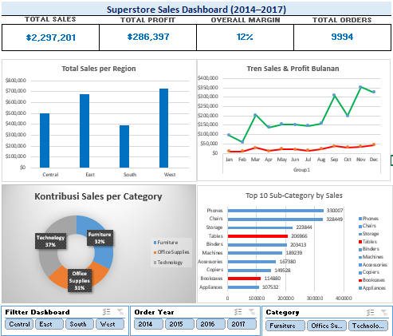

# Data Analyst Portfolio - Ferdiyanto Valentino

Halo! Saya lulusan Statistika yang sedang melakukan refresh skill untuk menjadi Data Analyst. 
Repository ini berisi perjalanan belajar 30 hari saya, mulai dari Excel, SQL, Python, hingga Visualisasi Data.

## 🚀 Proyek Utama: Superstore Profitability Analysis

**Latar Belakang Masalah:**
Manajemen Superstore menghadapi masalah penurunan margin profit meskipun penjualan meningkat. 

**Tujuan Analisis:**
Menemukan penyebab penurunan profitabilitas dan memberikan rekomendasi strategis berbasis data.

**Tools yang Digunakan:**
- **Excel:** Data cleaning, Pivot Table, Dashboard interaktif.
- **MySQL (DBeaver):** Analisis data, JOIN, CTE, Window Functions.

**Insight Utama & Rekomendasi:**
1. **Diskon Berlebih:** Transaksi dengan diskon >30% mengalami kerugian (profit negatif). *Rekomendasi: Evaluasi kebijakan diskon maksimal 20%.*
2. **Sub-Kategori Merugi:** 'Tables' dan 'Bookcases' mengalami kerugian signifikan sepanjang tahun. *Rekomendasi: Hentikan diskon untuk 2 sub-kategori ini.*
3. **Pola Musiman:** Penjualan melonjak di Q4 (Okt-Des) namun margin menipis. *Rekomendasi: Siapkan stok di Q3 dan kurangi diskon akhir tahun.*
4. **Konsentrasi Pelanggan:** 10 pelanggan teratas menyumbang profit yang sangat besar. *Rekomendasi: Program loyalitas khusus untuk VIP.*

**Silakan lihat detail query SQL di sini:** [`portofolio_superstore.sql`](./03_sql/portofolio_superstore.sql)

**Preview Dashboard Excel:**
